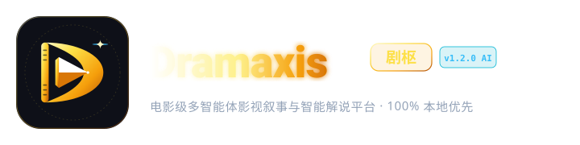
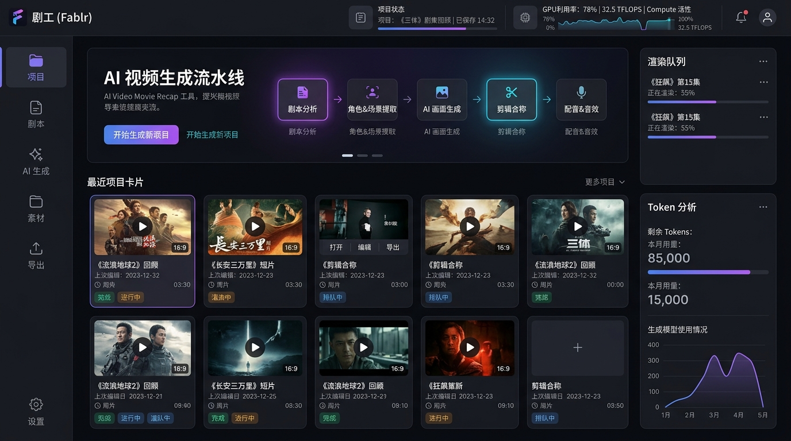
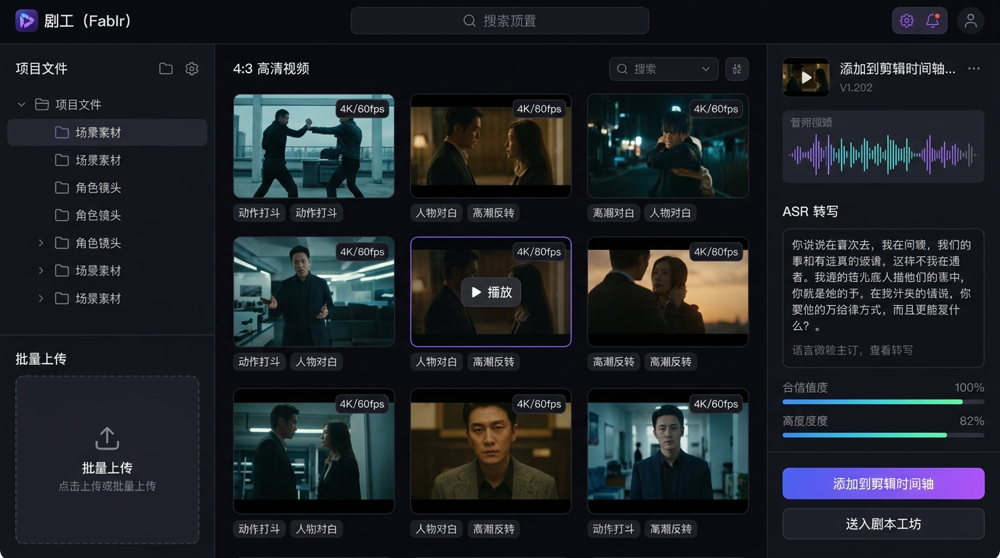
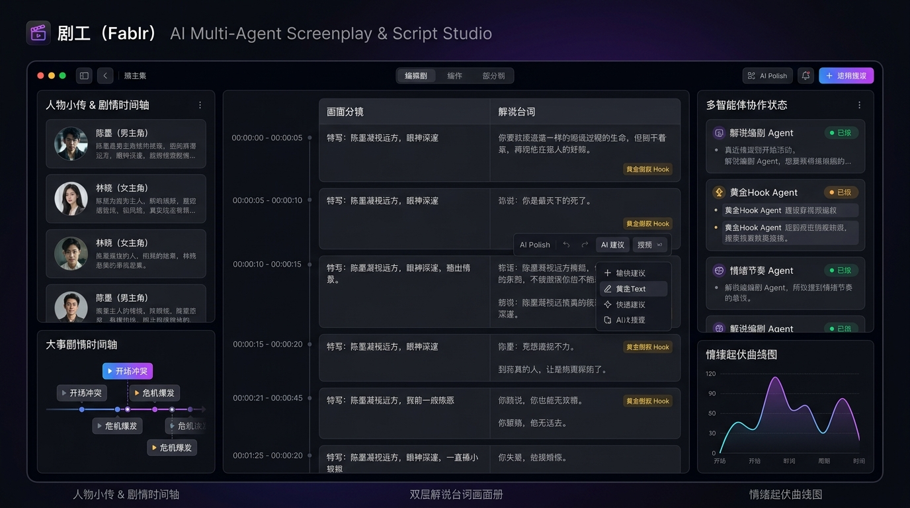
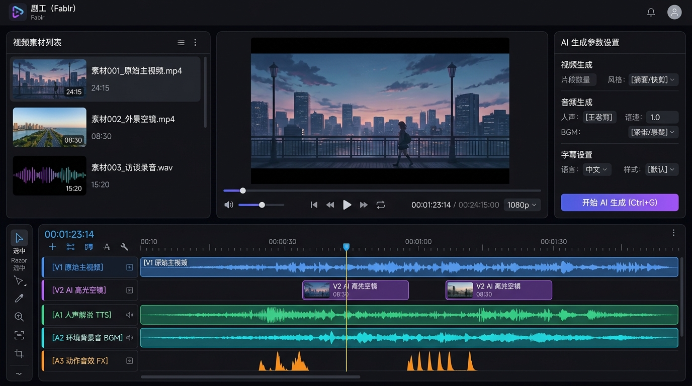
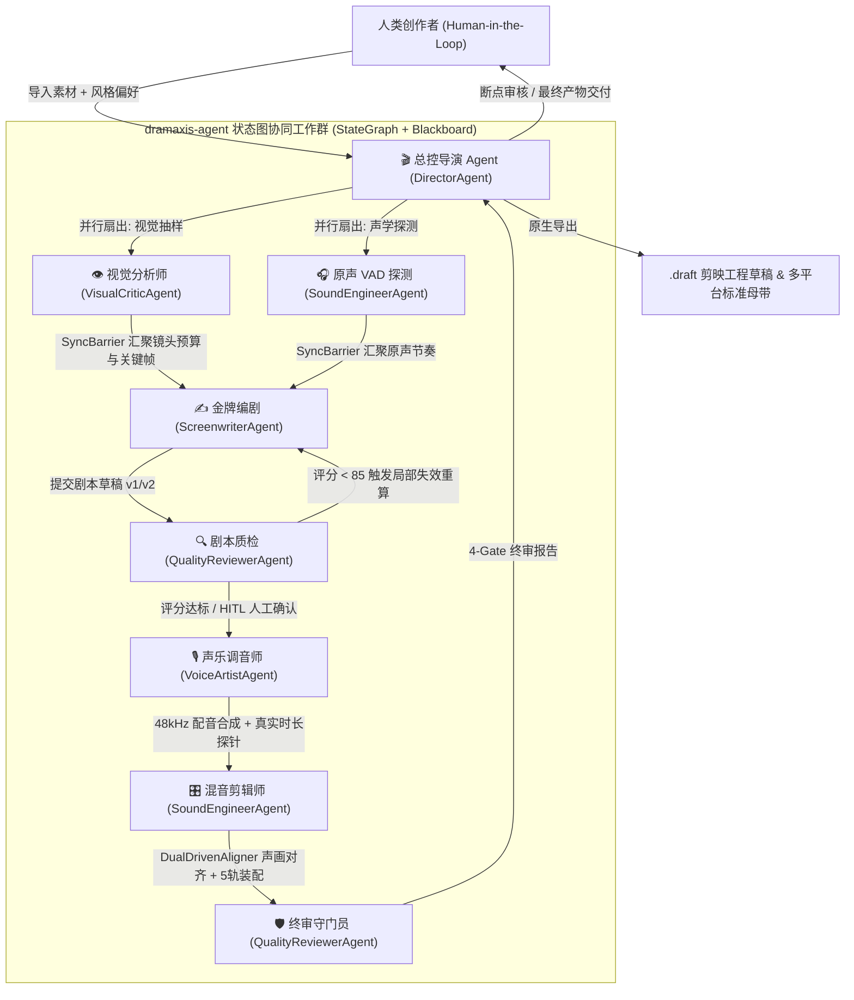

<!-- markdownlint-disable MD060 MD040 MD041 MD047 -->

<div align="center">



# 🎬 Dramaxis (剧枢)

> **电影级多智能体影视叙事与智能解说创作平台 · 本地优先 · 6 大智能体编导群 · 4 步工坊向导 · 5 轨毫秒级剪辑 · 剪映/CapCut 草稿深度互通 · 8 大平台合规母带分发**

[](https://github.com/Agions/dramaxis/releases)
[](https://tauri.app)
[](https://www.rust-lang.org)
[](https://react.dev)
[](https://www.typescriptlang.org)
[](LICENSE)
[](https://github.com/Agions/dramaxis)
[](https://github.com/Agions/dramaxis)
[](https://github.com/Agions/dramaxis)
[](https://github.com/Agions/dramaxis)

</div>

---

## 🎬 核心定位与设计理念

**Dramaxis（剧枢）** 是一款基于 **Rust Native 多智能体架构 (`StateGraph` + `Blackboard`) + Tauri 2 + React 19** 深度研发的电影级桌面端 AI 视频叙事与智能解说创作平台。

专为微短剧二次创作、影视解说、高光混剪及故事化自媒体创作者打造。通过 **三栏一体化专业集成工作台 (Integrated Cinema Studio)**、**4 大沉浸式创作工坊** 与 **6 大多智能体团队协作体系 (Multi-Agent Team)**，一键完成素材多模态抽帧、黄金 3 秒 Hook 构思、第一人称高潮独白撰写、多引擎语音合成、5 轨毫秒级声画对齐、剪映工程草稿（`.draft`）原生交付与多平台标准母带压制。

---

## 🖥️ 核心工坊界面概览 (Studio Interface Preview)

<div align="center">

| 工坊 1: 控制台仪表盘 (Home Dashboard) | 工坊 2: 素材拆条工坊 (Asset Hub) |
| :--------------------------------------------------------------------------------------------------------------------------------------------------------------: | :--------------------------------------------------------------------------------------------------------------------------------------------------------------: |
|  |  |

| 工坊 3: 剧本研磨工坊 (Script Studio) | 工坊 4: 音画剪辑工作台 (Workspace) |
| :--------------------------------------------------------------------------------------------------------------------------------------------------------: | :----------------------------------------------------------------------------------------------------------------------------------------------------------: |
|  |  |

</div>

---

## 🎭 Rust Native 多智能体协作架构 (Multi-Agent Team)



| 智能体角色 | 专业职责与底层算子底座 |
| :--- | :--- |
| **🎬 总控导演 (`Director`)** | 全局意图解析、工作流模板（`StandardDrama` / `FastCommentary` / `PureBrollMontage`）调度、`StyleProfile` 解构与人机协同断点 (`HITL`) 管理 |
| **👁️ 视觉分析师 (`VisualCritic`)** | `FFmpeg` 场景硬切检测、多模态关键帧抽取、`SceneRagEngine` 冲突度打分与镜头级字数预算分配 |
| **✍️ 金牌编剧 (`Screenwriter`)** | 多模态看图撰稿、4 大黄金 3 秒 `HookFormula` 应用、按镜头字数预算撰写第一人称独白，支持多版本演进与回滚 |
| **🎙️ 声乐调音师 (`VoiceArtist`)** | 对接 `Edge-TTS` / `OpenAI-TTS` / `GPT-SoVITS` / `MiniMax`，支持 SSML 语速控制与真实音频时长探针校验 |
| **🎛️ 混音剪辑师 (`SoundEngineer`)** | `silencedetect` VAD 语音端点检测、`DualDrivenAligner` 语义+情绪双驱动声画对齐、5 轨磁性装配与 BGM 侧链闪避 |
| **🔍 质量守门员 (`QualityReviewer`)** | `ScriptFlywheelEngine` 留存张力客观评估 + `LLM-as-a-Judge` 主观裁判双擎评审，以及成片 4-Gate（Hook/同步公差/节奏/合规）终审 |

---

## 🏭 四大核心创作工坊工作流 (Stage-Gate Workshops)

```text
┌─────────────────────────────────────────────────────────────────────────────┐
│                      Dramaxis (剧枢) 全链路创作工坊                           │
├───────────────────┬───────────────────┬───────────────────┬─────────────────┤
│ 1. 素材拆条工坊    │ 2. 剧本研磨工坊    │ 3. 剪辑合成工作台  │ 4. 母带交付中心 │
│   (Asset Hub)     │  (Script Studio)  │    (Workspace)    │  (Export Hub)   │
│ · 场景/镜头拆解   │ · 🪝 黄金3秒 Hook  │ · 📝 剧本/以文剪片│ · 剪映草稿直出   │
│ · 关键帧情感打标  │ · 📖 版本演进对比  │ · 🎬 5轨多轨时间轴│ · 发布合规体检  │
│ · Scene-RAG 检索  │ · 📈 留存张力波形  │ · 声画智能微变速  │ · 8大平台母带   │
└───────────────────┴───────────────────┴───────────────────┴─────────────────┘
```

### 🌐 8 大主流平台标准视听母带预设

内置面向国内与出海主流平台的标准化画幅、码率与侧链混流预设：
- 🇨🇳 **抖音 (Douyin)**：`1080x1920` (9:16) / 8000k 码率 / 9:16 高斯模糊环境底衬 / 智能人声闪避
- 🇨🇳 **快手 (Kuaishou)**：`1080x1920` (9:16) / 6000k 码率
- 🇨🇳 **小红书 (RED)**：`1080x1440` (3:4) 黄金比例画幅
- 🇨🇳 **微信视频号 (Channels)**：`1080x1920` (9:16) 自适应压制
- 🇨🇳 **哔哩哔哩 (Bilibili)**：`1920x1080` (16:9) 高码率横屏深度解说
- 🌏 **TikTok**：`1080x1920` (9:16) 高清出海规格
- 🌏 **YouTube & YouTube Shorts**：支持 60s 竖屏 Shorts（含时长合规校验）与 16:9 横屏长视频母带

---

## 🧠 11 大主流大模型与多引擎语音合成矩阵

### 11 大主流 LLM 引擎支持 (`dramaxis-script`)

- 🇨🇳 **通义千问 (Qwen)**：`qwen-plus` / `qwen-max` / `qwen-turbo`
- 🇨🇳 **DeepSeek**：`deepseek-chat` (V3) / `deepseek-reasoner` (R1)
- 🇺🇸 **OpenAI**：`gpt-4o` / `gpt-4o-mini`
- 🇺🇸 **Claude (Anthropic)**：`claude-3-7-sonnet-20250219` / `claude-3-5-sonnet`
- 🇺🇸 **Gemini (Google)**：`gemini-2.5-flash` / `gemini-2.5-pro`
- 🇨🇳 **Kimi (月之暗面)**：`moonshot-v1-auto`
- 🇨🇳 **智谱 GLM**：`glm-4-flash` / `glm-4-plus`
- 🇨🇳 **字节豆包 (Doubao)**：`doubao-pro-32k`
- 🇨🇳 **腾讯混元 (Hunyuan)**：`hunyuan-standard`
- 🏠 **本地离线模型 (Local)**：Ollama / LMStudio (`llama3.2` / `qwen2.5`)

---

## 🏛️ 项目结构与模块划分

```text
dramaxis/
├── src/                  # React 19 + TypeScript 5.8 三栏专业工作台
├── packages/             # 前端 Monorepo 模块 (@dramaxis/ipc, @dramaxis/core, @dramaxis/ui, @dramaxis/utils)
├── public/               # 运行时静态资产与品牌识别 (public/branding/)
├── src-tauri/            # Tauri 2.0 桌面端入口 (Cargo Workspace 根工作区)
│   ├── src/              # Tauri IPC 命令注册与薄分发层
│   └── crates/           # 11 个独立 Rust 业务微模块
│       ├── agent         # Rust Native 多智能体状态图与版本化黑板引擎 (StateGraph / Blackboard)
│       ├── core          # 核心基础设施 (AppContext / DramaxisError / 领域实体 domain.rs)
│       ├── intake        # 媒体导入校验、元数据探针与编排计划
│       ├── detect        # FFmpeg 智能探针 / 场景切片 / Scene-RAG 多模态感知 / GPU 加速探测
│       ├── script        # 11 大主流 LLM 客户端 / 黄金 3 秒 Hook 公式 / 留存张力飞轮
│       ├── voice         # Edge-TTS / OpenAI-TTS / GPT-SoVITS / MiniMax 语音合成
│       ├── subtitle      # FFmpeg silencedetect VAD 语音端点检测与 SRT/VTT/ASS 字幕生成
│       ├── compose       # 语义+情绪双驱动声画对齐 (DualDrivenAligner) 与多轨合成算子
│       ├── export        # 剪映草稿 (.draft) 原生工程导出与多平台标准母带压制
│       ├── storage       # 本地 SQLite / .dramaxis 工程包持久化与 Keychain 凭证隔离
│       └── update        # 跨平台自动更新引擎
└── docs/                 # VitePress 官方架构与开发文档中心
```

---

## 🛠️ 本地极速开发

```bash
# 1. 克隆代码仓库
git clone https://github.com/Agions/dramaxis.git
cd dramaxis

# 2. 安装前端依赖
pnpm install

# 3. 启动桌面端开发环境
pnpm tauri dev

# 4. 运行全套自动化测试
cargo test --manifest-path src-tauri/Cargo.toml --all
pnpm test
```

> **💡 macOS 安装提示**：若打开下载的安装包时提示 `“已损坏，无法打开”`，系 macOS Gatekeeper 安全机制对未签名文件的隔离标记，请在终端执行：
> `sudo xattr -rd com.apple.quarantine /Applications/Dramaxis.app` 即可正常启动。

---

## 📜 许可证

基于 **[MIT License](LICENSE)** 许可协议开源。

© 2026 Agions · Powered by Tauri 2, Rust & React 19
