# Monorepo 架构与双向隔离设计 (Monorepo Architecture)

splicr 采用 **双向 Monorepo (Dual-Workspace Monorepo)** 架构：
- **后端**：基于 Cargo Workspace 编排 12 个独立的 Rust Crates。
- **前端**：基于 pnpm Workspace 拆分为 4 个可复用 NPM Packages。

---

## 1. 仓库拓扑结构

```mermaid
graph TD
    subgraph RustWorkspace ["Cargo Workspace (src-tauri/crates/*)"]
        splicr_core["splicr-core (领域实体/DI)"]
        splicr_agent["splicr-agent"]
        splicr_script["splicr-script"]
        splicr_voice["splicr-voice"]
        splicr_subtitle["splicr-subtitle"]
        splicr_detect["splicr-detect"]
        splicr_intake["splicr-intake"]
        splicr_compose["splicr-compose"]
        splicr_export["splicr-export"]
        splicr_storage["splicr-storage"]
        splicr_plugin["splicr-plugin"]
        splicr_update["splicr-update"]
    end

    subgraph TauriApp ["Tauri Host (src-tauri)"]
        Tauri["splicr (src-tauri)"]
    end

    subgraph PnpmWorkspace ["pnpm Workspace (packages/*)"]
        pkg_ipc["@splicr/ipc"]
        pkg_core["@splicr/core"]
        pkg_ui["@splicr/ui"]
        pkg_utils["@splicr/utils"]
    end

    subgraph WebApp ["React App (src/)"]
        App["splicr App (src/)"]
    end

    Tauri --> splicr_core
    Tauri --> splicr_agent
    Tauri --> splicr_compose
    Tauri --> splicr_update

    App --> pkg_ipc
    App --> pkg_core
    App --> pkg_ui
    App --> pkg_utils
```

---

## 2. 架构拆分收益与约束

### 1. 彻底杜绝循环依赖
- 领域实体全部集中在 `splicr-core::domain` 中，其他 11 个 Crate 仅单向依赖 `splicr-core`。
- 前端 `packages/ui` 纯粹承载表现组件，绝不反向依赖业务 Store 或具体路由视图。

### 2. 独立编译缓存与极速构建
- 修改前端 UI 组件不会触发 Rust 耗时重编译。
- 修改底层某单一 Crate（如 `splicr-update`），增量编译可在 2~3 秒内极速完成。
