# Monorepo 架构与双向隔离设计 (Monorepo Architecture)

Dramaxis 采用 **双向 Monorepo (Dual-Workspace Monorepo)** 架构：

- **后端**：基于 Cargo Workspace 编排 11 个独立的 Rust Crates。
- **前端**：基于 pnpm Workspace 拆分为 4 个可复用 NPM Packages (`@dramaxis/*`)。

---

## 1. 仓库拓扑结构

```mermaid
graph TD
    subgraph RustWorkspace ["Cargo Workspace (src-tauri/crates/*)"]
        dramaxis_core["dramaxis-core (领域实体/错误/DI)"]
        dramaxis_agent["dramaxis-agent (StateGraph/Blackboard)"]
        dramaxis_script["dramaxis-script (11 LLM/Hook/Flywheel)"]
        dramaxis_voice["dramaxis-voice (Edge/OpenAI/SoVITS/Mimo)"]
        dramaxis_subtitle["dramaxis-subtitle (VAD/SRT/ASS)"]
        dramaxis_detect["dramaxis-detect (FFmpeg/Scene-RAG)"]
        dramaxis_intake["dramaxis-intake (媒体导入/编排计划)"]
        dramaxis_compose["dramaxis-compose (DualDrivenAligner/混流)"]
        dramaxis_export["dramaxis-export (剪映草稿/多平台母带)"]
        dramaxis_storage["dramaxis-storage (SQLite/.dramaxis/Keychain)"]
        dramaxis_update["dramaxis-update (自动更新)"]
    end

    subgraph TauriApp ["Tauri Host (src-tauri)"]
        Tauri["dramaxis (src-tauri)"]
    end

    subgraph PnpmWorkspace ["pnpm Workspace (packages/*)"]
        pkg_ipc["@dramaxis/ipc"]
        pkg_core["@dramaxis/core"]
        pkg_ui["@dramaxis/ui"]
        pkg_utils["@dramaxis/utils"]
    end

    subgraph WebApp ["React App (src/)"]
        App["Dramaxis Studio (src/)"]
    end

    Tauri --> dramaxis_core
    Tauri --> dramaxis_agent
    Tauri --> dramaxis_compose
    Tauri --> dramaxis_export
    Tauri --> dramaxis_storage
    Tauri --> dramaxis_update

    dramaxis_agent --> dramaxis_detect
    dramaxis_agent --> dramaxis_script
    dramaxis_agent --> dramaxis_voice
    dramaxis_agent --> dramaxis_subtitle
    dramaxis_agent --> dramaxis_compose

    App --> pkg_ipc
    App --> pkg_core
    App --> pkg_ui
    App --> pkg_utils
```

---

## 2. 架构拆分收益与约束

### 1. 彻底杜绝循环依赖

- 核心领域实体全部集中在 `dramaxis-core::domain` 中，其他 10 个 Crate 单向依赖 `dramaxis-core`。
- `dramaxis-agent` 作为顶层智能编排层，单向调用 `detect`、`script`、`voice`、`subtitle`、`compose` 提供的底层原子算子，底层算子库绝不反向依赖 `dramaxis-agent`。
- 前端 `@dramaxis/ui` 纯粹承载通用表现组件，绝不反向依赖业务 Store 或具体路由视图。

### 2. 独立编译缓存与极速构建

- 修改前端 UI 组件不会触发 Rust 耗时重编译。
- 修改底层某单一 Crate（如 `dramaxis-export` 或 `dramaxis-script`），增量编译可在数秒内完成。
