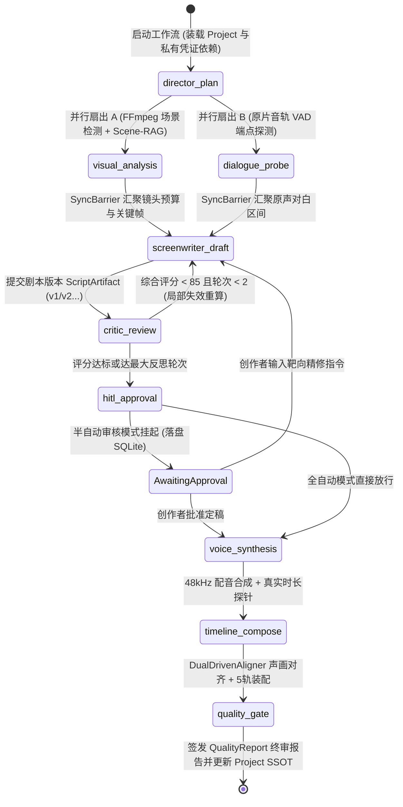

# 6-Agent 协同中枢与状态图引擎 (Multi-Agent Engine)

Dramaxis 的多智能体系统基于 **声明式动态状态图 (`StateGraph`)**、**强类型版本化黑板总线 (`Blackboard`)** 与 **实时事件广播总线 (`agent://event`)** 构建，实现了支持并发扇出、屏障归约、局部拓扑失效重算与人机协同断点 (`HITL`) 的工业级协同机制。

---

## 1. 状态图编排生命周期 (`StateGraph`)

以默认微短剧全流程模板 (`WorkflowProfile::StandardDrama` 9 节点) 为例：



---

## 2. 核心智能体角色与状态定义 (`crates/agent/src/types.rs`)

Rust 端定义了强类型的 6 大智能体角色、工作流模板与执行状态：

```rust
#[derive(Debug, Clone, Copy, PartialEq, Eq, Serialize, Deserialize, Default)]
#[serde(rename_all = "snake_case")]
pub enum WorkflowProfile {
    #[default]
    StandardDrama,    // 完整微短剧 (9节点：多模态分析 + 编剧 + 反思闭环 + HITL + 配音 + 5轨对齐 + 终审)
    FastCommentary,   // 极速影视解说 (7节点：关键帧萃取 + 极速撰稿 + HITL + 配音 + 5轨对齐 + 终审)
    PureBrollMontage, // 纯画面高光混剪 (4节点：混剪统筹 + 高能切点分析 + 卡点混流 + 连贯度终验)
}

#[derive(Debug, Clone, Copy, PartialEq, Eq, Serialize, Deserialize)]
#[serde(rename_all = "snake_case")]
pub enum AgentRole {
    Director,
    VisualCritic,
    Screenwriter,
    VoiceArtist,
    SoundEngineer,
    QualityReviewer,
}

#[derive(Debug, Clone, Copy, PartialEq, Eq, Serialize, Deserialize)]
#[serde(rename_all = "snake_case")]
pub enum AgentStatus {
    Idle,
    Thinking,
    Acting,
    AwaitingApproval,
    Completed,
    Failed,
}
```

---

## 3. 强类型版本化黑板总线 (`Blackboard`) 与无锁并发

各智能体摒弃弱类型字符串哈希表，统一通过 `Blackboard` (`crates/agent/src/blackboard.rs`) 读写强类型领域产物，并遵循**无锁快照读取 + 增量原子归约**原则：

- **视觉感知产物 (`VisualBriefArtifact`)**：记录视频总时长、场景切点列表、关键帧本地缓存路径及镜头级标注 `Vec<ShotAnnotation>`（含运动强度、冲突得分、情绪标签与单镜目标字数预算 `target_word_budget`）。
- **听觉感知产物 (`AudioBriefArtifact`)**：基于 `dramaxis-subtitle::vad` 提取的原片人声区间 `Vec<SpeechInterval>` 与声学能量峰值。
- **剧本版本链 (`Vec<ScriptArtifact>`)**：完整保留自反思与人工批注产生的 `v1, v2, v3...` 历史版本、使用的 Hook 公式、留存张力分项得分（`hook_score` / `pacing_score` / `conflict_score`）及质检修改建议，支持一键版本回滚 (`rollback_script_to_version`)。
- **配音与时间轴产物 (`VoiceArtifact` & `TimelineArtifact`)**：记录经过真实文件校验与 `ffprobe` 测长的配音文件路径，以及经 `DualDrivenAligner` 装配生成的 5 轨时间线摘要。
- **四重门禁终审报告 (`QualityReportArtifact`)**：汇总黄金 3 秒 Hook 评分、毫秒级声画同步公差 (`sync_tolerance_ms`)、叙事节奏匹配度与内容合规校验结果。
