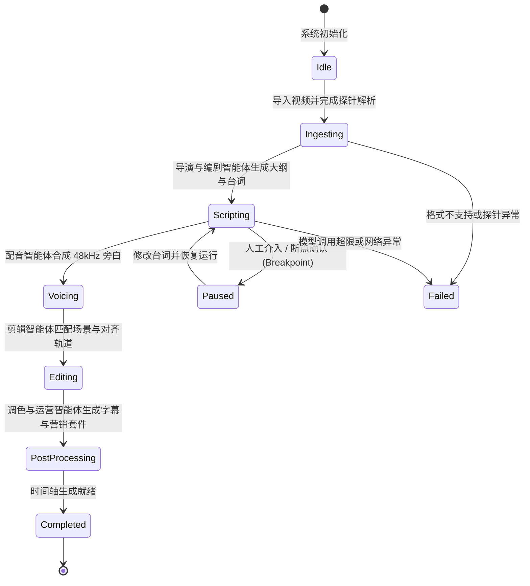

# 6-Agent 协同中枢与状态机 (Multi-Agent Engine)

splicr 的多智能体系统基于 **流水线状态机 (Pipeline State Machine)** 与 **事件广播总线 (Event Broadcast Bus)** 构建，实现了高内聚低耦合的智能体协同机制。

---

## 1. 状态机流转生命周期



---

## 2. 核心智能体状态定义 (`crates/agent/src/types.rs`)

Rust 端定义了强类型的智能体角色与执行状态：

```rust
#[derive(Debug, Clone, Copy, PartialEq, Eq, Serialize, Deserialize)]
#[serde(rename_all = "kebab-case")]
pub enum AgentRole {
    Director,
    Screenwriter,
    VoiceArtist,
    Editor,
    Colorist,
    Operator,
}

#[derive(Debug, Clone, Copy, PartialEq, Eq, Serialize, Deserialize)]
#[serde(rename_all = "kebab-case")]
pub enum AgentStatus {
    Idle,
    Running,
    Paused,
    Completed,
    Failed,
}
```

---

## 3. 上下文记忆与状态共享 (`AgentContext`)

各智能体通过 `AgentContext` 共享上下文状态，避免跨模块强耦合：
- **项目元数据**：原始视频时长、高潮关键帧列表、用户选定的解说风格与目标受众。
- **分段脚本缓存**：每个 `ScriptSegment` 包含台词文本、指定情绪标签、预估时间戳与对齐镜头索引。
- **音频产物指针**：由 Voice Artist 智能体生成的本地 WAV/MP3 缓存路径及波形数据。
