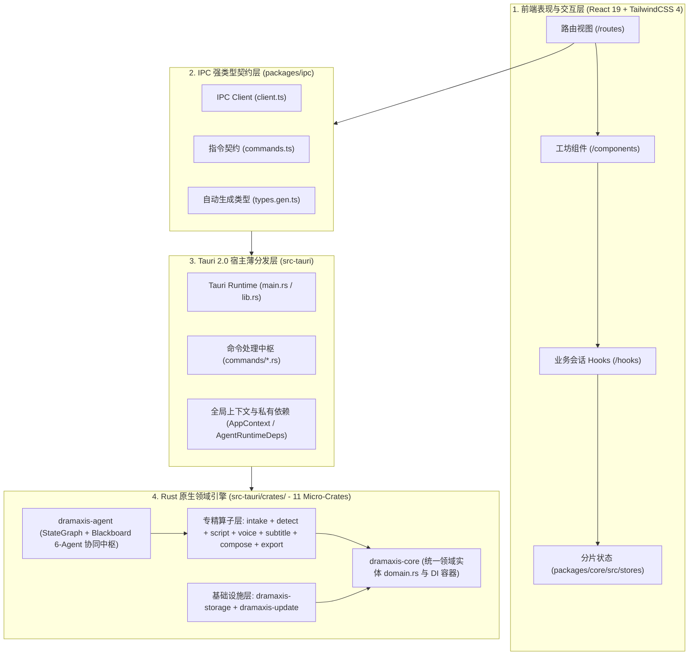

# 全栈架构拓扑与洋葱模型 (Architecture Overview)

Dramaxis 采用现代桌面工程的高内聚、低耦合架构设计，严格遵循 **Clean Architecture (洋葱架构)**、**单向依赖原则** 与 **StateGraph + Blackboard 读写分离状态管理**。

---

## 1. 系统分层拓扑图

---

## 2. 四大核心分层职责

### 1. 前端交互与视觉渲染层 (`src/` & `packages/ui`)

- **技术栈**：React 19、TypeScript 5.8、TanStack Router/Query、TailwindCSS 4。
- **职责**：
  - 承载专业电影级调色台三栏工作台 UI 与自适应主题视觉系统。
  - 驱动 5 轨毫秒级多媒体时间轴虚拟化渲染与高频播控时钟隔离 (`usePlaybackStore`)。
  - 通过 Zustand 分片管理项目 (`useProjectStore`)、工坊 (`useWorkshopStore`)、设置、素材与更新状态。

### 2. 强类型契约层 (`packages/ipc`)

- **职责**：
  - 充当前后端之间的坚固防火墙，通过 `scripts/gen-ipc.mjs` 静态反射 Rust 结构体与枚举，自动生成对应的 TypeScript 类型定义 (`types.gen.ts`)。
  - 严禁前端使用弱类型绕过契约直接调用后端，严禁后端在 IPC 返回载荷中夹带明文 API Key。

### 3. Tauri 2.0 宿主中枢层 (`src-tauri`)

- **职责**：
  - 承载桌面应用生命周期管理、系统原生窗口与文件对话框权限管控。
  - 解析来自前端的 Tauri Command 并注入 `AppContext` 及私有运行时依赖 `AgentRuntimeDeps`，分发至底层的 Rust 领域服务。

### 4. Rust 原生领域微模块集群 (`src-tauri/crates/`)

- **职责**：
  - 11 个独立的 Cargo Workspace Crate，各自拥有清晰的边界与单一职责。
  - 涵盖音视频硬件探针、VAD 静音断句、Scene-RAG 场景感知、LLM 多模态调度、留存张力飞轮、双驱动声画对齐、剪映草稿生成与多平台母带硬件加速渲染。
  - 核心领域模型统一收敛至 `crates/core/src/domain.rs`，消除循环依赖与重复定义。
