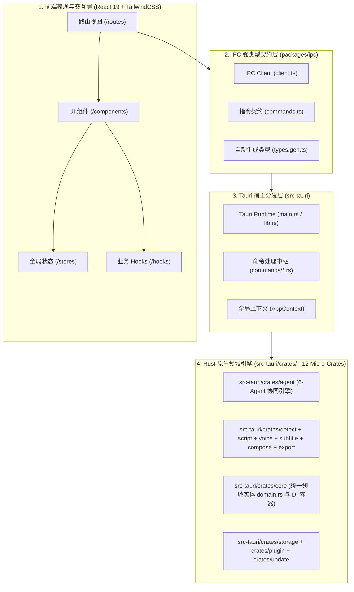

# 全栈架构拓扑与洋葱模型 (Architecture Overview)

splicr 采用现代桌面工程的高内聚、低耦合架构设计，严格遵循 **Clean Architecture (洋葱架构)** 与 **单向依赖原则**。

---

## 1. 系统分层拓扑图

---

## 2. 四大核心分层职责

### 1. 前端交互与视觉渲染层 (`src/` & `packages/ui`)
- **技术栈**：React 19、TypeScript 5.8、TanStack Router/Query、TailwindCSS 4。
- **职责**：
  - 承载专业电影级调色台 UI 交互与深色/金色视觉系统。
  - 驱动 5 轨毫秒级多媒体时间轴虚拟化渲染。
  - 通过 Zustand 分片管理项目、设置、素材与更新状态。

### 2. 强类型契约层 (`packages/ipc`)
- **职责**：
  - 充当前后端之间的坚固防火墙，通过 `scripts/gen-ipc.mjs` 静态反射 Rust 结构体与枚举，自动生成 100% 对应的 TypeScript 类型定义 (`types.gen.ts`)。
  - 严禁前端使用任意 `any` 或弱类型调用后端。

### 3. Tauri 2.0 宿主中枢层 (`src-tauri`)
- **职责**：
  - 承载桌面应用生命周期管理、系统原生托盘、窗口震动 (Vibrancy) 特效与原生菜单。
  - 解析来自前端的 44 个 Tauri Command 并注入 `AppContext` 依赖容器，分发至底层的 Rust 领域服务。

### 4. Rust 原生领域微模块集群 (`crates/`)
- **职责**：
  - 12 个完全独立的 Cargo Workspace Crate，各自拥有清晰的边界与单一职责。
  - 涵盖音视频硬件探针、VAD 断句、场景突变检测、LLM 多模态调度与剪映草稿二进制封装。
  - 核心领域模型统一收敛至 `crates/core/src/domain.rs`，消除循环依赖与重复定义。
