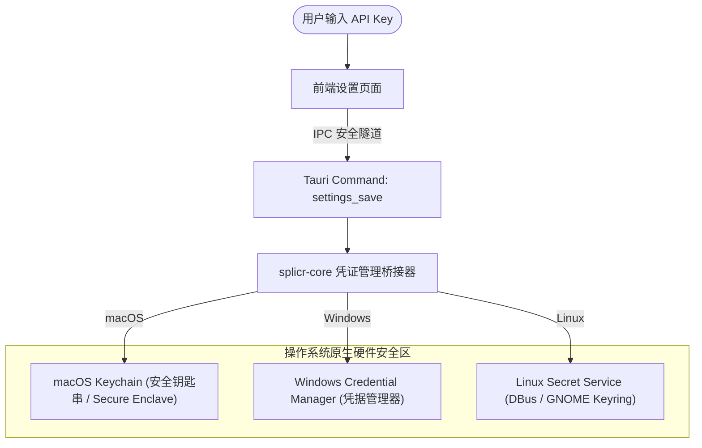

# 安全体系与 Keychain 凭证隔离 (Security & Keychain)

在桌面 AI 应用中，用户的 API Key（如 OpenAI、Claude、DeepSeek 等）及第三方存储凭证属于高危敏感数据。splicr 采用严格的 **硬件级/系统级安全隔离架构**。

---

## 1. 凭证安全存储架构

- **严禁明文落地**：任何 API Key 绝对禁止以明文形式写入前端 `localStorage`、本地 JSON 配置文件或 SQLite 数据库中。
- **内存即用即毁**：在发起大模型或 TTS 请求时，系统临时从 Keychain 读取密钥注入 HTTP Header，请求完成后立即清空内存缓冲区。

---

## 2. 进程沙箱与隔离机制

- **Tauri IPC 白名单隔离**：严格定义每个前端页面与组件可调用的命令范围，未授权命令直接在 IPC 边界处拦截并审计报错。
- **本地文件读写白名单**：通过 Tauri 2 作用域配置 (`tauri.conf.json` fs 插件权限），严格限制应用仅可访问项目工作区与系统临时缓存目录。
