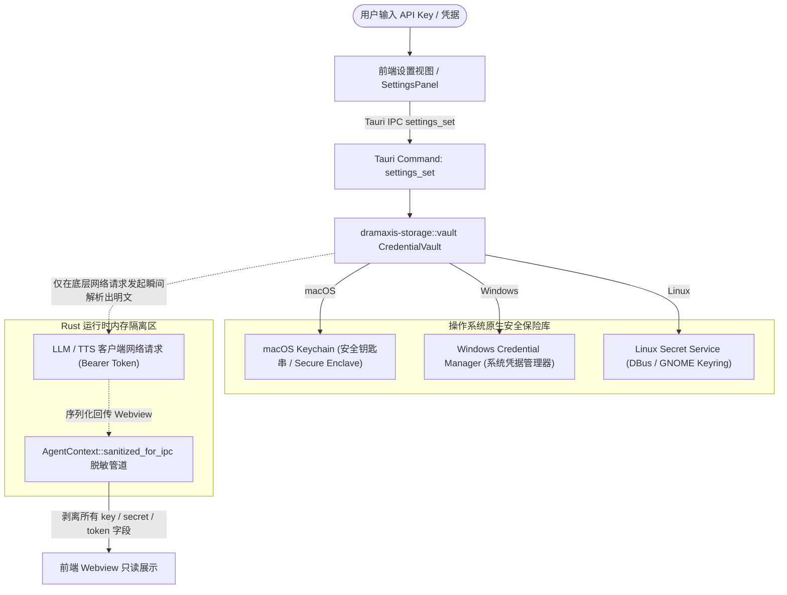

# 安全体系与 Keychain 凭证隔离架构 (Security & Keychain)

在桌面端 AI 应用工程中，用户配置的商业大模型 API Key（通义千问、DeepSeek、OpenAI、Claude、Gemini 等）属于高危资产。Dramaxis 实行严格的 **操作系统级物理隔离、运行时内存脱敏与跨进程零泄露安全架构**。

---

## 1. 凭证全生命周期安全拓扑



---

## 2. 核心安全防御准则

### 1. 跨 IPC 传输强制脱敏管道 (`sanitized_for_ipc`)
在多智能体协同推演中，`AgentContext` 包含复杂的会话上下文与历史记忆。为了彻底杜绝凭证泄露：
- 在 `AgentContext` 结构体上内建专属脱敏算子：
  ```rust
  pub fn sanitized_for_ipc(&self) -> Self {
      let mut cloned = self.clone();
      cloned.memory.retain(|k, _| {
          let lower = k.to_lowercase();
          !lower.contains("key")
              && !lower.contains("secret")
              && !lower.contains("token")
              && !lower.contains("password")
      });
      cloned
  }
  ```
- 所有向前端返回上下文的 Tauri Command（如 `agent_start` 与 `agent_get_context`）均强制经由此管道脱敏，Webview 前端与 DevTools 永远接触不到内存明文密钥。

### 2. 严禁前端持久化明文凭据
前端禁止在 `localStorage`、`sessionStorage`、IndexedDB 或前端缓存中保存任何 API 密钥。所有配置只读展示脱敏掩码（如 `sk-****abcd`）。

### 3. FFmpeg 命令注入防御 (Command Injection Defense)
所有调用系统 FFmpeg 与 FFprobe 的底层接口（`dramaxis-detect`、`dramaxis-subtitle`、`dramaxis-export`）一律使用操作系统原生的 `tokio::process::Command::args` 离散参数列表模式，严禁使用任何 `sh -c` 或字符串拼接模式，彻底杜绝特殊符号导致的恶意代码注入。

### 4. 路径遍历防御 (Path Traversal Defense)
所有缩略图缓存生成均使用 `<cache_dir>/thumb/<sha256(path)>.jpg` 进行内容寻址重命名，禁止直接拼接不可信的输入素材路径作为磁盘文件名；Tauri 2 权限体系 (`src-tauri/capabilities/default.json`) 严格锁定文件系统访问作用域。
