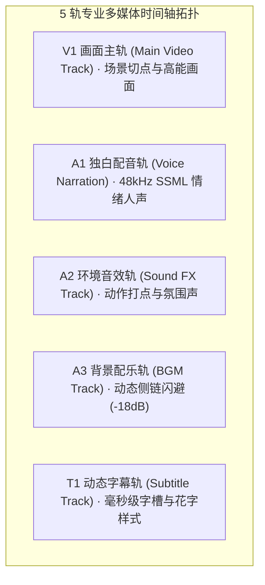

# dramaxis-compose · 5 轨毫秒级磁吸与声画双驱动编排引擎

`dramaxis-compose` 承载了 Dramaxis 核心的时间轴图元装配、语义+情绪双驱动声画对齐算法 (`DualDrivenAligner`)、BGM 侧链智能避让 (Audio Ducking) 以及 7 步底层基础流水线算子库。

---

## 1. 5 轨多媒体工程拓扑与时间轴模型

引擎维护严格的 5 轨层级结构，支持在纳秒/毫秒级精度上对片段执行非破坏性裁剪与磁吸排布：



### 轨道交互原则
- **主从约束**：以 A1 独白人声轨的真实时长为时间轴骨架标尺，V1 画面切片依据 `DualDrivenAligner` 自动伸缩或重采样适配；
- **磁性吸附 (Magnetic Snap)**：时间轴拖拽与智能体自动排布时，片段边界自动吸附至场景硬切点或语音停顿气口；
- **侧链智能避让 (Sidechain Ducking)**：实时监测 A1 轨 RMS 电平。当人声发声时，A3 配乐轨平滑衰减 `-12dB` ~ `-18dB`；台词停顿超过 250ms 时平缓回弹。

---

## 2. 语义+情绪双驱动对齐算法 (`DualDrivenAligner`)

在 `alignment.rs` 中，`DualDrivenAligner` 解决了传统 AI 剪辑按时长机械均分导致“声画脱节”的致命缺陷：

```rust
pub struct DualDrivenAligner;

impl DualDrivenAligner {
    /// 综合语义关联度、情绪强度偏置与时间序流转计算最佳声画匹配矩阵
    pub fn align_scenes_to_script(
        scenes: &[SceneCut],
        scripts: &[ScriptSegment],
    ) -> Vec<AlignmentMatch> {
        // 1. 构建 N x M 候选相似度矩阵
        // 2. 结合情绪标签 (如 suspense, climax, resolution) 计算情绪偏置权重
        // 3. 施加时间序单调性惩罚 (Temporal Progression Constraint)
        // 4. 动态规划 (DP) 求解全局最优解，消除时间倒流与镜头回溯
    }
}
```

```text
匹配综合得分计算公式：
Score(i, j) = 0.5 * SemanticSim(i, j) + 0.3 * EmotionMatch(i, j) - 0.2 * TemporalDistance(i, j)
```

---

## 3. 底层 7 步主流水线算子契约 (`executors.rs`)

`dramaxis-compose` 亦作为底层线性执行库，为各智能体提供标准化原子步骤：

| 步骤编号 | 步骤 ID | 职能定义 | 输入参数 | 产物输出 | 降级策略 |
| :-: | :--- | :--- | :--- | :--- | :--- |
| **0** | `intake` | 素材存在性与编码探测 | `project.media_files` | 媒体元数据 | 无素材立即终止 (fail-fast) |
| **1** | `detect` | 物理切点与关键帧抽样 | 原始媒体流 | `project.scripts` 骨架 | 降级为等距黄金节奏切片 |
| **2** | `script` | 爆款独白剧本创作 | 分镜骨架 + LLM 配置 | 第一人称分段解说 | 降级为单段保底剧本 |
| **3** | `voice` | 48kHz 广播级配音 | 分段文案 + TTS 配置 | 真实音频路径与时长 | 降级为本地微静音音频 |
| **4** | `subtitle` | VAD 断句与花字排版 | 语音真实波形 | 字幕图元与时间戳 | 生成标准对齐字幕 |
| **5** | `compose` | 5 轨装配与多流混音 | 视频 + 配音 + BGM | 合成中间工程 | 降级为无混流纯视频工程 |
| **6** | `export` | 剪映草稿/母带压制 | 组装好的工程模型 | 剪映包或 MP4 成片 | 依赖 FFmpeg 环境支持 |
