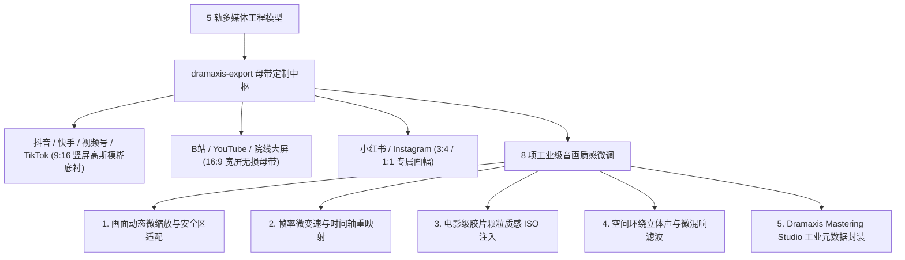

# dramaxis-export · 剪映原生草稿直出与多平台标准母带渲染

`dramaxis-export` 负责将组装好的 5 轨 `Timeline` 多媒体工程直出为剪映 PC 端 (CapCut / JianYing Pro) 原生工程草稿包 (`.draft`)，并提供基于 GPU 硬件加速（Apple VideoToolbox / NVIDIA NVENC / Intel QSV / VAAPI）的多平台标准母带压制、EBU R128 响度标准化、多画幅自适应以及多渠道差异化母带批处理能力。

---

## 1. 剪映原生草稿工程构造规范 (`capcut.rs`)

引擎通过深入分析剪映 PC 端的工程文件协议，无需中间格式中转即可直接构建合法的剪映工程包：

```text
com.lveditor.draft/<draft_id>/
├── draft_info.json         # 剪映版本签名 (draft_version) 与全局平台标识
├── draft_content.json      # 5 轨映射 (视频/配音/环境声/BGM/花字字幕)、转场与音量动画关键帧
├── draft_meta_info.json    # 草稿预览时长、高能封面图映射与缩放比例
└── draft_cover.jpg         # 视频首帧或高潮关键帧自动抽取的封面
```

### 零重编码软映射优势
- **位流级纯净传递**：精准将各轨道素材引用路径与入出点微秒时间戳 (`start_seconds` / `in_seconds` / `out_seconds`) 写入 JSON，无需耗费数十秒乃至几十分钟进行像素解码与重新压缩；
- **全要素二次精修**：在剪映专业版中打开即可保留全部音视频独立分轨与文本图元，无缝利用剪映丰富的特效库二次包装。

---

## 2. 多平台母带定制与多渠道批处理 (`dedup.rs` & `renderer.rs`)



### 硬件加速压制与 EBU R128 响度归一化
- **GPU 硬件编码器自动感知 (`resolve_hardware_encoder`)**：
  自动侦测并启用当前硬件平台的最优编码加速器（macOS `h264_videotoolbox`、NVIDIA `h264_nvenc`、Intel `h264_qsv`、Linux `h264_vaapi`），发生异常时平滑回退至高兼容性软解 `libx264`。
- **广播级声学响度归一化**：
  集成 EBU R128 工业规范，自动将母带集成响度压制在 `-14 LUFS` 至 `-16 LUFS` 标准听感范围，彻底消除不同平台播放时声音忽大忽小或爆音削顶的缺陷。

---

## 3. 核心契约数据结构

```rust
pub struct RenderVideoResult {
    pub output_path: String,
    pub duration_seconds: f64,
    pub size_bytes: u64,
}

pub struct CapcutDraftResult {
    pub draft_folder: String,
    pub content_file: String,
    pub meta_file: String,
    pub tracks_count: usize,
    pub clips_count: usize,
}
```
