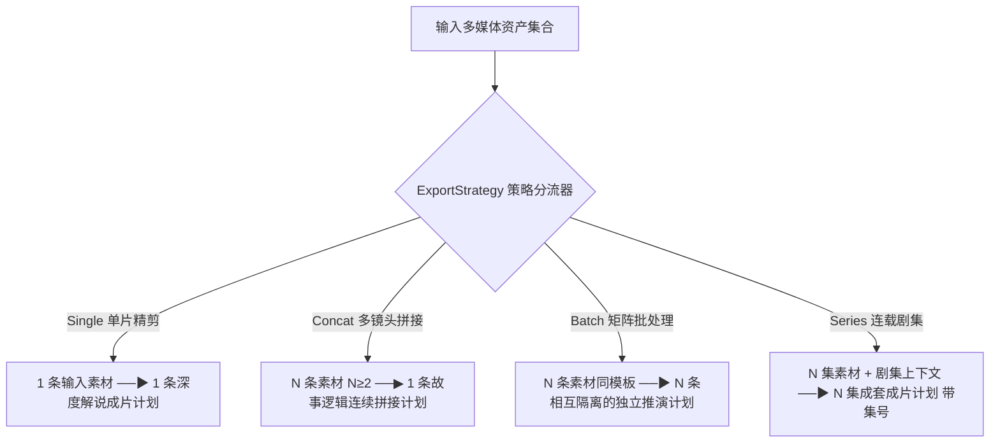

# dramaxis-intake · 4 大影视生产策略分流与资产编排引擎

`dramaxis-intake` 是 Dramaxis 资产摄取与业务策略分流的核心算子。它的职责是执行**纯函数式的编排规划与前置语义校验**（Pure Planning），根据选定的生产模式将原始多媒体资产精准映射为确定的交付计划序列 (`Vec<OutputPlan>`)，并将真正的重度 FFmpeg I/O 下沉至下游算子。

---

## 1. 四大影视生产策略语义契约

引擎严格复用 `dramaxis_core::domain::ExportStrategy`，针对不同影视创作场景实施确定性的输入校验与计划分流：



### 策略约束与验证矩阵

| 策略标识 | 素材数量约束 | 必备扩展参数 | 校验失败错误 (`VideoPlanError`) | 生产场景 |
| :--- | :--- | :--- | :--- | :--- |
| **`Single`** | 必须恰好输入 1 个视频 | 无 | `SourceCountMismatch` (需要 1 条) | 单部长篇电影深度解说、单一爆款短剧混剪 |
| **`Concat`** | 必须输入 $\ge 2$ 个视频片段 | 无 | `SourceCountMismatch` (需要 $\ge 2$ 条) | 多机位镜头按序装配、短剧剧情连续切片拼装 |
| **`Batch`** | 必须输入 $\ge 1$ 个视频 | 无 | `SourceCountMismatch` (需要 $\ge 1$ 条) | 矩阵化批量解说、海量短视频切片自动化上产 |
| **`Series`** | 必须输入 $\ge 1$ 个视频 | `series_context` (剧集背景描述) | `MissingSeriesContext` / `BadEpisodeTemplate` | 连载网络短剧、长剧分集解说与人物统一叙事 |

---

## 2. 计划配置与产物模型 (`src/lib.rs`)

```rust
use std::path::PathBuf;
use dramaxis_core::domain::ExportStrategy;

/// 编排计划输入参数
#[derive(Debug, Clone, Default)]
pub struct PlanOptions {
    /// 剧集主题描述 (Series 策略下必填，供导演与编剧理解宏观故事设定)
    pub series_context: Option<String>,
    /// 起始集号编号 (默认从 1 开始递增)
    pub episode_start: Option<u32>,
    /// 集号命名模版，必须携带 `{n}` 占位符 (例如: "第{n}集_高能反转")
    pub episode_template: Option<String>,
}

/// 确定的下游执行计划单元
#[derive(Debug, Clone, PartialEq, Eq)]
pub struct OutputPlan {
    /// 计划唯一标识 (UUID)
    pub id: String,
    /// 建议工程标题
    pub title: String,
    /// 按序排列的输入素材物理路径
    pub ordered_sources: Vec<PathBuf>,
    /// 推荐输出文件名
    pub suggested_output_name: String,
    /// 当前集号编号 (仅 Series 策略下为 Some)
    pub episode_index: Option<u32>,
}
```

---

## 3. 快速调用与前置校验示例

```rust
use dramaxis_core::domain::ExportStrategy;
use dramaxis_intake::{build_plans, PlanOptions};
use std::path::PathBuf;

// 1. Concat 策略编排
let sources = vec![PathBuf::from("scene_01.mp4"), PathBuf::from("scene_02.mp4")];
let plans = build_plans(&sources, ExportStrategy::Concat, &PlanOptions::default())?;
assert_eq!(plans.len(), 1);
assert_eq!(plans[0].ordered_sources.len(), 2);

// 2. Series 连载策略编排
let series_sources = vec![PathBuf::from("ep1_raw.mp4"), PathBuf::from("ep2_raw.mp4")];
let series_opts = PlanOptions {
    series_context: Some("都市逆袭短剧《绝地龙神》全集背景".into()),
    episode_template: Some("《绝地龙神》第{n}集".into()),
    episode_start: Some(1),
};
let series_plans = build_plans(&series_sources, ExportStrategy::Series, &series_opts)?;
assert_eq!(series_plans.len(), 2);
assert_eq!(series_plans[0].suggested_output_name, "《绝地龙神》第1集.mp4");
```
