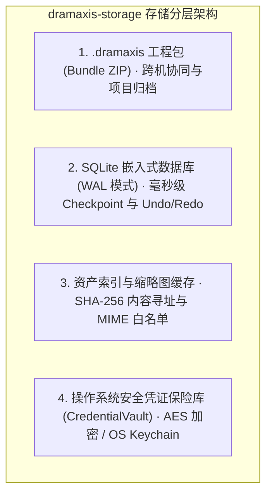

# dramaxis-storage · SQLite/WAL 资产持久化与凭证安全保险库

`dramaxis-storage` 负责 Dramaxis 本地资产索引、嵌入式 SQLite/WAL 数据库持久化、撤销重做版本栈 (`Undo/Redo`)、打包工程包 (`.dramaxis Bundle`) 以及操作系统级安全凭证保险库 (`CredentialVault`)。

---

## 1. 架构拓扑与存储分层



---

## 2. 嵌入式 SQLite 与事物化 Checkpoint (`db.rs`)

为了实现影视级非编软件必备的高性能撤销与重做，引擎在本地启动内嵌 SQLite 引擎，并默认启用 **WAL (Write-Ahead Logging)** 模式，保证多线程读写的绝对 ACID 特性与零锁竞争：

```rust
use rusqlite::Connection;

/// 初始化数据库表结构与索引
pub fn init_database(conn: &Connection) -> Result<(), rusqlite::Error> {
    // 1. 工程基础信息表 (projects)
    // 2. 状态机 Checkpoint 检查点表 (checkpoints)
    // 3. 历史版本撤销栈表 (undo_redo_stacks)
}

/// 保存关键节点检查点 (支持跨会话断点恢复)
pub fn save_checkpoint(
    conn: &Connection,
    session_id: &str,
    step_name: &str,
    snapshot_json: &str,
) -> Result<(), rusqlite::Error>;

/// 栈式撤销与重做算子
pub fn undo(conn: &Connection, project_id: &str) -> Result<Option<Project>, rusqlite::Error>;
pub fn redo(conn: &Connection, project_id: &str) -> Result<Option<Project>, rusqlite::Error>;
```

---

## 3. 标准工程归档包 (`.dramaxis Bundle`) (`bundle.rs`)

除了本地关系型数据库，Dramaxis 提供了跨机器流转与项目冻结的标准工程归档文件格式 `.dramaxis`：

```text
my_project.dramaxis (ZIP 容器)
├── project.json        # 核心工程实体 (Project 元数据、设置与参数)
├── timeline.json       # 5 轨毫秒级时间轴与片段剪辑点
├── checkpoints/        # 智能体推演历史与分段剧本版本链 (v1, v2...)
└── assets_manifest.json# 素材 SHA-256 校验和与相对路径索引
```

- **单文件便携性**：创作者可直接通过邮件、网盘分发 `.dramaxis` 工程包给后期团队；
- **增量打包与版本迁移**：提供向后兼容的版本适配与平滑迁移机制。

---

## 4. 资产索引与内容寻址 (`lib.rs`)

```rust
pub struct AssetEntry {
    pub id: String,
    pub path: String,
    pub filename: String,
    pub kind: AssetKind,
    pub size_bytes: u64,
    /// 确定性 SHA-256 哈希，用于瞬时去重与缓存命中
    pub sha256: String,
    pub thumbnail_path: Option<String>,
}
```

- **安全防御**：缩略图缓存路径严格采用 `<cache_dir>/thumb/<sha256(path)>.jpg`，彻底防止路径遍历（Path Traversal）漏洞；
- **目录递归扫描**：内建安全深度限制（最大 8 层）与媒体 MIME 白名单（支持 `.mp4`, `.mov`, `.mkv`, `.avi`, `.webm`, `.mp3`, `.wav`, `.flac` 等）。

---

## 5. 凭证安全保险库 (`vault.rs`)

`CredentialVault` 负责管理所有大语言模型 API Key 与私有网关令牌。在 macOS 上优先与 `Security.framework` (Keychain) 握手，在 Windows 上接入 `Credential Manager`，杜绝任何以明文形态在配置文件或日志中持久化密钥的风险。
