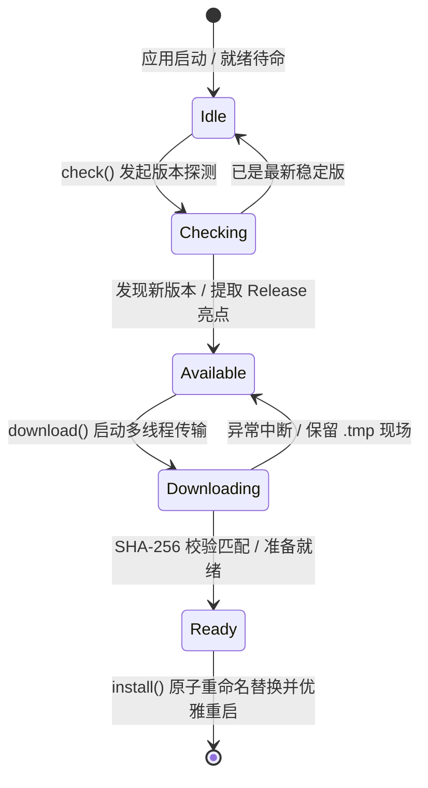

# dramaxis-update · 跨平台断点续传与原子自更新引擎

`dramaxis-update` 是 Dramaxis 桌面客户端的持续集成与在线分发服务。它基于 GitHub Releases API 与 Tauri Updater 机制构建，提供包括 HTTP Range 断点续传、滑动窗口平滑测速、SHA-256 完整性防篡改校验以及跨平台本地二进制原子替换。

---

## 1. 五阶段全双工状态机 (5-Phase State Machine)

更新服务内部封装了强状态机，严格杜绝重复拉取与脏数据覆盖，并通过 Tauri Event 向前端实时推送事件流：



---

## 2. 关键工业特性

### 1. HTTP Range 断点续传
当在弱网或网络断开时发生下载中断，引擎自动保存已有临时切片并记录字节偏移量；网络恢复重试时自动附加 `Range: bytes={offset}-` 头部，仅拉取增量包数据，免除百兆安装包反复全量下载的流量浪费。

### 2. 400ms 滑动窗口平滑测速 (`speed_bps`)
传统的瞬时测速在弱网或网络抖动时往往导致 UI 界面剧烈跳动。`dramaxis-update` 引入 400ms 时间戳滑动窗口平滑衰减算法，稳定输出平滑的字节每秒速率 (`speed_bps`) 与极其平稳的预估剩余秒数 (`remaining_seconds`)。

### 3. 强制升级 (Force Update) 与安全阻断仲裁
引擎解析 Release Notes 中的元标记与 SemVer 语义化版本规则：
- 当主版本号递增（如 `v1.x` $\rightarrow$ `v2.x`）或更新日志中检测到 `[critical]`, `[force]`, `[security]` 标记时，自动标记 `is_force: true`；
- 前端拦截普通弹窗关闭动作，阻断高危漏洞版本继续执行底层流操作。

### 4. 原子重命名与平滑热替换
更新包先全量落盘至 `.dramaxis-update.tmp` 隐藏文件，经 SHA-256 哈希校验完全匹配后，执行操作系统级的文件描述符原子重命名操作（`rename`），随后通知 Tauri 主事件循环执行 `app_handle.restart()`，保证升级过程发生断电或强退时主应用绝对不损坏。

---

## 3. 核心契约数据结构

```rust
use serde::{Deserialize, Serialize};

/// 线上版本信息元数据
#[derive(Debug, Clone, Serialize, Deserialize)]
pub struct UpdateInfo {
    pub version: String,
    pub release_date: Option<String>,
    pub notes: Option<String>,
    pub download_url: Option<String>,
    pub sha256: Option<String>,
    pub file_size_bytes: Option<u64>,
    pub is_force: bool,
    pub highlights: Vec<String>,
}

/// 毫秒级下载进度事件载荷
#[derive(Debug, Clone, Serialize, Deserialize)]
pub struct UpdateProgress {
    pub downloaded_bytes: u64,
    pub total_bytes: u64,
    pub percent: u8,
    pub speed_bps: u64,
    pub remaining_seconds: Option<u64>,
}
```
