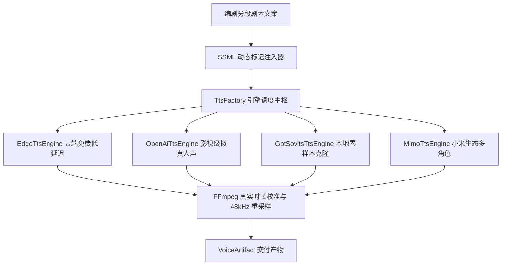

# dramaxis-voice · 48kHz 影视级语音合成与音色克隆引擎

`dramaxis-voice` 负责影视剧解说的人声合成、角色声线匹配、SSML 停顿与语速控制，以及基于本地 GPT-SoVITS 的零样本音色克隆。引擎输出的音频严格重采样至 **48kHz 广播级工业标准**，并具备毫秒级真实时长探针校准能力。

---

## 1. 核心架构与多引擎工厂

`dramaxis-voice` 通过 `TtsEngine` Trait 抽象底层语音合成管线，支持多供应商无缝热切换：



### 支持的引擎特性矩阵

| 引擎代号 | 接入形式 | 认证要求 | 代表音色与音质 | 典型适用场景 |
| :--- | :--- | :--- | :--- | :--- |
| **`EdgeTtsEngine`** | WebSocket 直连 | 免密钥 (开箱即用) | `zh-CN-YunxiNeural`, `zh-CN-YunjianNeural` (高保真) | 绝大多数影视解说、快速试听与工业批量生产 |
| **`OpenAiTtsEngine`** | REST API | OpenAI API Key | `alloy`, `echo`, `fable`, `onyx`, `nova`, `shimmer` | 国际化双语解说、高拟真人声独白 |
| **`GptSovitsEngine`** | 本地 HTTP/RPC | 本地推理权重服务 | 参考 3~5 秒参考音频零样本复刻声音特征 | 经典角色原声复刻、专属解说音色 IP 打造 |
| **`MimoTtsEngine`** | Cloud API | 小米开放凭证 | 丰富中文短剧角色库、对话对白 | 多角色多视角互动式剧情演绎 |

---

## 2. SSML 动态修饰与语速控制 (`ssml.rs`)

为了消除传统 TTS 机械生硬的朗读感，引擎在发送请求前自动将情绪标签转换为合法的 W3C SSML 标记，并对 XML 特殊字符进行自动转义防注入：

```rust
pub fn build_ssml(text: &str, voice: &str, rate_percent: i32) -> String {
    let escaped = escape_xml(text);
    let rate_str = if rate_percent >= 0 {
        format!("+{rate_percent}%")
    } else {
        format!("{rate_percent}%")
    };

    format!(
        r#"<speak version="1.0" xmlns="http://www.w3.org/2001/10/synthesis" xml:lang="zh-CN"><voice name="{voice}"><prosody rate="{rate_str}">{escaped}</prosody></voice></speak>"#
    )
}
```

---

## 3. 真实时长探针与离线保底保障

在视频剪辑工程中，预估时长与真实发音时长微小的几百毫秒偏差即可导致全片音画脱节。`dramaxis-voice` 实施了两重可靠性保障：

1. **真实时长探针校准**：
   合成成功后，引擎主动调用 `dramaxis-detect::Ffmpeg::probe` 读取生成音频的毫秒级准确时长，作为下游 `DualDrivenAligner` 磁吸排布的唯一基准。
2. **离线与断网确定性保底**：
   若处于完全离线环境或外部 TTS 服务发生网络超时，引擎将通过本地 FFmpeg 生成合法的微静音音频并写入缓存，杜绝由于外部网络抖动导致输出不存在的虚构路径引发下游渲染崩溃。
