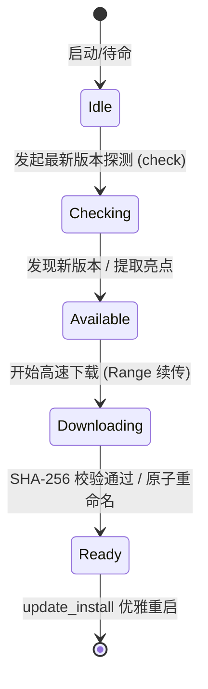

# splicr-update · 断点续传与原子替换自更新引擎

`splicr-update` 是客户端自动化版本管理中枢，基于官方 GitHub Releases API 构建，支持断点续传、滑动窗口平滑测速、SHA-256 校验与应用内原地原子替换。

---

## 1. 五阶段更新状态机 (5-Phase State Machine)



---

## 2. 核心特性

- **HTTP Range 断点续传**：探测未完成的 `.tmp` 缓存，自动携带 `Range: bytes={offset}-` 恢复下载。
- **400ms 滑动窗口平滑测速**：实时计算瞬时下载速率 (`speed_bps`) 与预计剩余秒数 (`remaining_seconds`)。
- **强制更新 (Force Update) 判定**：自动识别大版本跃迁及更新日志中的 `[critical]`, `[force]`, `[security]` 标记。
- **原子替换与优雅重启**：下载至临时文件，校验成功后原子替换并调用 `app.restart()`。

---

## 3. 核心数据结构

```rust
pub struct UpdateInfo {
    pub version: String,
    pub release_date: Option<String>,
    pub notes: Option<String>,
    pub download_url: Option<String>,
    pub sha256: Option<String>,
    pub file_size_bytes: Option<u64>,
    pub is_force: bool,
    pub highlights: Vec<String>,
}

pub struct UpdateProgress {
    pub downloaded_bytes: u64,
    pub total_bytes: u64,
    pub percent: u8,
    pub speed_bps: u64,
    pub remaining_seconds: Option<u64>,
}
```
