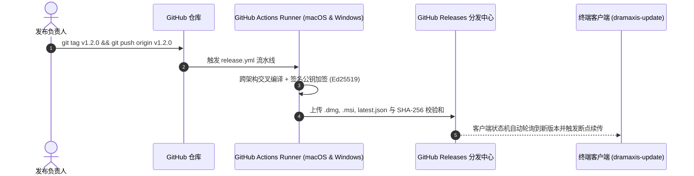

# 跨平台构建打包与持续交付指南 (Build & Release)

本文档面向运维工程师与发行负责人，详细说明如何打包编译 **Dramaxis (剧枢)** 生产环境的跨平台桌面客户端安装包以及部署官方静态架构文档站点。

---

## 1. 架构文档站点构建与校验

Dramaxis 官方文档站点基于 VitePress 构建，集成严格的本地死链检测与排版风格自动化审查：

```bash
# 启动本地开发热重载服务器 (http://localhost:5173)
pnpm docs:dev

# 执行文档全量格式规范与超链接完整性校验
pnpm docs:check

# 生产环境静态打包 (编译产物输出至 docs/.vitepress/dist/)
pnpm docs:build

# 本地无缓存预览编译后静态产物
pnpm docs:preview
```

---

## 2. 跨平台桌面客户端打包编译

在打包发布前，必须在本地或 CI 流水线中全量通过代码合规、严格类型检查与单元测试验证：

```bash
# 1. 前端类型严格检查与单元测试
pnpm tsc --noEmit
pnpm test

# 2. Rust 后端全量测试与代码规范检查 (无警告红线)
cargo test --manifest-path src-tauri/Cargo.toml --all
cargo clippy --manifest-path src-tauri/Cargo.toml --all

# 3. 执行 Tauri 2 生产级打包
pnpm tauri build
```

### 产物发行形态矩阵

| 目标系统 | 架构要求 | 输出安装包格式 | 输出目录位置 |
| :--- | :--- | :--- | :--- |
| **macOS** | Apple Silicon (`aarch64`) / Intel (`x86_64`) | `.dmg` 磁盘镜像 / `.app` 应用程序包 | `src-tauri/target/release/bundle/dmg/` |
| **Windows** | x64 架构 | `.msi` (WiX 引擎) / `.exe` (NSIS 便携安装器) | `src-tauri/target/release/bundle/msi/` |

---

## 3. GitHub Actions 自动化发行工作流

Dramaxis 配置了工业级云端持续交付 (CI/CD) 矩阵流水线：



1. **版本签名与加固**：
   所有发行版本在编译后自动生成对应的 SHA-256 Checksum 与 Ed25519 签名密钥，杜绝网络传输劫持风险；
2. **差分更新清单 (`latest.json`)**：
   CI 构建完成后自动生成包含更新日志、版本号与分发 CDN 地址的清单，直通客户端内的 `dramaxis-update` 引擎。
