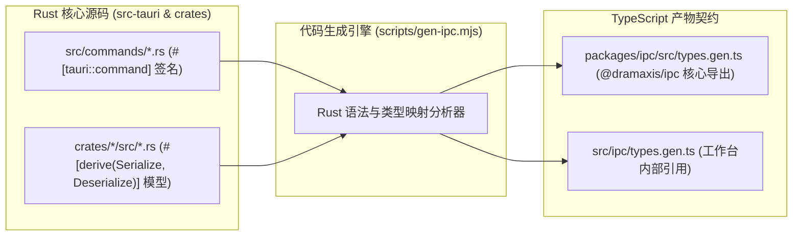

# IPC 代码自动化生成与类型契约同步机制 (gen-ipc)

Dramaxis 采用基于 AST 与静态分析的自动化代码生成工具链 (`scripts/gen-ipc.mjs`)，确保 Rust 后端结构体与 TypeScript 前端接口保持 100% 强类型同步，彻底杜绝人工书写接口契约带来的类型漂移与运行时未捕获异常。

---

## 1. 编译流水线与工作原理



---

## 2. 类型对齐与映射规则矩阵

引擎内部严格定义了 Rust 原生强类型到 TypeScript 类型的转换映射标准：

| Rust 类型表达 | TypeScript 目标类型 | 语义说明与处理细节 |
| :--- | :--- | :--- |
| `String` / `&str` / `PathBuf` | `string` | 字符序列与文件绝对路径 |
| `u8` / `u32` / `u64` / `usize` | `number` | 整型计数器与字节偏移 |
| `f32` / `f64` | `number` | 浮点秒数、坐标位置与匹配评分 |
| `bool` | `boolean` | 逻辑开关与断点判定 |
| `Option<T>` | `T \| null` | 严格映射为联合 null 表达 |
| `Vec<T>` / `&[T]` | `T[]` | 数组切片序列 |
| `HashMap<String, V>` | `Record<string, V>` | 动态字典映射 |
| `Result<T, DramaxisError>` | `Promise<T>` | 成功解包为 T，失败转为客户端 Promise 异常 |
| `enum` (Unit 变体) | 联合字面量 (`"single" \| "batch"`) | 严格遵循 `#[serde(rename_all = "...")]` 规则 |

---

## 3. 开发者指南与 CI/CD 守护

在日常研发中，凡是新增或修改了 `#[tauri::command]` 算子或涉及 IPC 的 Rust 数据结构，只需运行以下指令即可刷新前端类型：

```bash
# 触发全量类型提取与自动化生成
pnpm gen:ipc

# 验证 TypeScript 严格编译无死角
pnpm tsc --noEmit
```

在 GitHub Actions CI 流水线中，系统通过 `pnpm gen:ipc:check` 执行零漂移守护：若有开发者修改了 Rust 接口却未提交重新生成的 TypeScript 契约，CI 将立即失败阻断合并，确保生产发布的代码百分之百安全可控。
