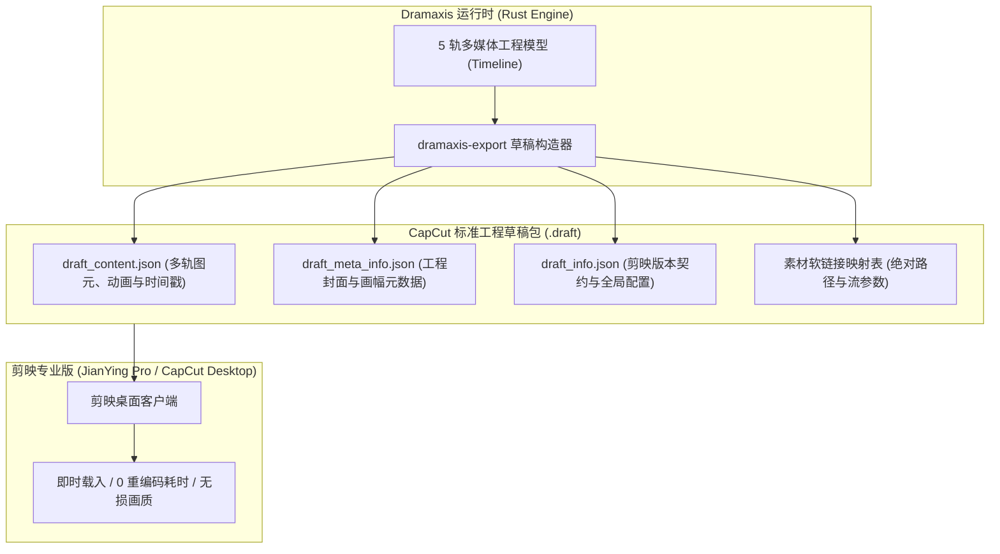

# 剪映 PC 端原生工程草稿 (.draft) 导出技术指南

Dramaxis (剧枢) 的核心工业级优势之一在于支持 **零转码直出剪映 PC 端 (CapCut / JianYing Pro) 原生工程草稿**。

传统 AI 视频生产流水线通常需要耗费数分钟至数十分钟对视频进行全帧 GPU/CPU 渲染与重新编码。创作者一旦需要微调某句台词、调色或替换局部镜头，往往必须推倒重来。Dramaxis 打破这一痛点，直接在二进制与工程 DSL 层面构建剪映草稿，实现毫秒级工程导出与无缝后期精修。

---

## 1. 架构拓扑与零转码机制



### 核心设计优势

1. **零编码延迟 (Zero Transcoding Latency)**：
   仅需序列化工程描述文件并建立元数据索引，几百兆乃至数千兆的项目均可在 100ms 内生成完整工程，免去长时间的 GPU/CPU 视频压制等待。
2. **母带级全保真 (Bitstream-level Lossless)**：
   完全继承原始素材的最高分辨率、高动态范围 (HDR/HLG)、色深与采样率，杜绝二次重编码造成的画质衰减与色带断层。
3. **全轨独立解绑 (Multi-track Independent Composability)**：
   主视频切片、独白配音人声轨、环境氛围音效轨、背景配乐轨与动态花字字幕轨处于完全独立可编辑状态，保留了影视级专业二修能力。

---

## 2. 剪映工程目录结构规范

Dramaxis 依照剪映专业版的工程协议标准在本地目标目录下生成标准包：

```text
com.lveditor.draft/
└── <draft_id>/
    ├── draft_content.json      # 核心轨道拓扑、片段起始点、过渡转场与字幕花字
    ├── draft_info.json         # 剪映版本签名 (draft_version)、工程名称与系统标识
    ├── draft_meta_info.json    # 封面缩略图索引、时长统计与时间轴缩放比例
    └── draft_cover.jpg         # 视频首帧或高潮关键帧自动抽取的工程封面图
```

### 关键 JSON 字段解析

- **`draft_content.json`**：
  - `tracks`: 严格按照 5 轨层级定义视频轨（`type: "video"`）、音频轨（`type: "audio"`）与文本轨（`type: "text"`）。
  - `materials`: 统一收集引用的原始媒体文件路径、音高变速参数与字幕图元样式（文字大小、字体包、描边参数、阴影透明度）。
  - `segments`: 对应时间轴切片，维护 `source_timerange`（素材裁剪区间）与 `target_timerange`（时间轴放置时间点）。

---

## 3. 标准导出与操作步骤

### 第一步：时间轴工程校验与监看

在 Dramaxis **「制作工坊」** 确认时间轴装配状态：
- 确认独白人声轨与视频切片关键动作点已由 `DualDrivenAligner` 自动对齐。
- 确认已选定预期的花字字幕风格（如“琥珀金调光”）。

### 第二步：触发剪映草稿直出

1. 点击界面右上角 **「导出 (Export)」➔「导出剪映草稿」**。
2. 系统底层将自动探测宿主机操作系统中的剪映草稿默认存储路径：
   - **macOS**：`~/Movies/JianyingPro/User Data/Projects/com.lveditor.draft/`
   - **Windows**：`C:\Users\<用户名>\AppData\Local\JianyingPro\User Data\Projects\com.lveditor.draft\`
3. 输入草稿命名（如 `【剧枢解说】绝地反击_EP01`），点击 **「立即创建」**。

### 第三步：剪映唤醒与二次包装

1. 启动剪映专业版（JianYing Pro 或 CapCut Desktop）。
2. 在客户端首屏「本地草稿」列表中，Dramaxis 生成的草稿已立即可见。
3. 双击打开工程：
   - 视频片段、人声独白、BGM 与字幕全部归位就绪。
   - 创作者可直接调用剪映内置的特有能力（如一键智能抠像、高级变音、画中画粒子特效与音效音效包）进行润色。

---

## 4. 生产注意事项与故障排查

> [!IMPORTANT]
> **素材路径软引用约定**：
> 剪映工程草稿通过本地绝对路径建立媒体索引。导出草稿后，请切勿移动、重命名或清理导入的原视频文件与配音临时目录；若出现提示「素材丢失」，可在剪映弹窗中一键重新关联原始目录。

- **多版本适配矩阵**：
  Dramaxis 草稿构造器兼容剪映 PC 端 v4.x、v5.x、v6.x 及 CapCut Desktop 全版本。
- **动态字幕样式继承**：
  导出的字幕文本片段已携带字体大小、行间距与描边色彩，打开工程即可直接渲染，无需在剪映内重新排版。
