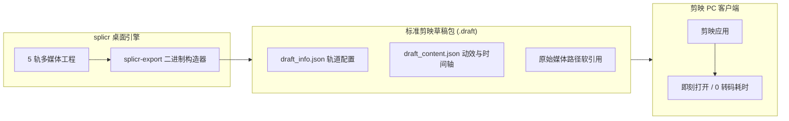

# 剪映 PC 端原生草稿 (.draft) 导出流程

splicr 的一大工业级特色是 **直接导出剪映 PC 端 (CapCut / JianYing) 原生工程草稿**。

传统 AI 视频工具通常需要花费数分钟甚至数小时进行视频整体重编码导出 MP4，一旦需要微调某句台词或替换某个镜头，必须从头重新渲染。splicr 直击痛点，秒级生成原生剪映草稿，无缝衔接后期精修。

---

## 1. 原理与架构优势

- **0 重编码耗时**：毫秒级输出草稿，省去长达数十分钟的 GPU/CPU 视频重编码。
- **100% 无损画质**：保留原始视频的最高码率、HDR 色彩空间与原始音频通道。
- **全轨道独立可编辑**：主视频轨、解说音频轨、BGM 音乐轨、音效轨、动态字幕轨均处于完全解绑的独立编辑状态。

---

## 2. 导出操作指南

### 第一步：检查时间轴对齐
在生产页面完成 AI 编排后，确认时间轴上的音视频对齐与字幕排版无误。

### 第二步：触发剪映草稿导出
1. 点击右上角 **「导出 (Export)」➔「导出剪映草稿」**。
2. 系统弹窗将自动探测您本机安装的剪映 PC 端草稿默认存储目录：
   - **macOS 默认路径**：`~/Movies/JianyingPro/User Data/Projects/com.lveditor.draft/`
   - **Windows 默认路径**：`C:\Users\<Username>\AppData\Local\JianyingPro\User Data\Projects\com.lveditor.draft\`
3. 填写草稿名称（如：`《黑神话》深度剧情解说_第1集`），点击 **「立即创建草稿」**。

### 第三步：在剪映中打开并二次精修
1. 启动剪映 PC 端客户端。
2. 在首页「本地草稿」列表中，您将直接看到由 splicr 生成的工程草稿项目。
3. 双击打开草稿：
   - 所有解说人声、BGM 避让点、视频切片与花字字幕均已精准放置在时间线上。
   - 您可以直接利用剪映内置的丰富转场特效、变音滤镜、贴纸与智能抠像进行二次加工。

---

## 3. 注意事项与常见问题

> [!WARNING]
> 剪映草稿采用的是媒体文件路径引用机制。导出草稿后，请勿移动或删除原始视频素材文件所在目录，否则剪映打开时会提示「媒体文件丢失，需要重新关联」。

- **字幕样式映射**：splicr 生成的标准字幕轨会自动映射为剪映的默认文本花字。
- **多平台版本兼容**：支持剪映 PC 端 v4.x / v5.x / v6.x 及国际版 CapCut Desktop 全系列。
