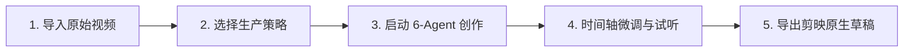

# 快速上手 (Getting Started)

欢迎使用 **splicr** —— 工业级 Multi-Agent AI 视频解说与工程化桌面引擎。本文档将带您在 3 分钟内完成环境准备并生成第一部 AI 影视解说作品。

---

## 1. 系统要求与环境准备

在启动 splicr 之前，请确保您的机器满足以下基础环境：

| 平台 | 最低配置要求 | 推荐配置 |
| :--- | :--- | :--- |
| **macOS** | macOS 12 (Monterey) 及以上 (Intel / Apple Silicon) | macOS 14+ (Apple Silicon M1/M2/M3/M4) |
| **Windows** | Windows 10 64-bit (1909+) | Windows 11 64-bit |
| **内存 (RAM)** | 8 GB | 16 GB 及以上 |
| **外部工具** | 系统已安装 `ffmpeg` 与 `ffprobe` (或使用内置捆绑工具) | FFmpeg 6.0+ 支持硬件加速 (VideoToolbox / NVENC) |

> [!TIP]
> splicr 启动时会自动检测系统环境变量中的 `ffmpeg` 与 `ffprobe`。若未检测到，可在「设置 ➔ 环境配置」中手动指定二进制路径。

---

## 2. API Key 凭证配置

splicr 支持 11 大行业主流 LLM 大模型与多种 TTS 语音合成供应商。首次使用请配置至少一个大模型与语音服务：

1. 打开 splicr 客户端，点击左侧导航栏底部的 **⚙️ 设置 (Settings)**。
2. 进入 **模型与凭证 (Providers & API Keys)** 选项卡：
   - **大语言模型**：填入您的 API Key（如 OpenAI、DeepSeek、Anthropic Claude、阿里云通义千问等）。
   - **TTS 语音合成**：支持免 Key 的 Edge TTS，亦可配置 OpenAI TTS、GPT-SoVITS 或小米 MiMo 等专属音色服务。
3. 点击 **保存配置**，系统将自动将敏感密钥加密存储在操作系统的安全钥匙串 (macOS Keychain / Windows Credential Manager) 中。

---

## 3. 从零创建您的第一部解说作品

### 第一步：导入素材与探针解析
1. 点击左侧主导航 **🏠 工作台 (Home)** ➔ **新建项目 (New Project)**。
2. 将待解说的影视剧切片、电影片段或短剧视频拖入素材导入区。
3. splicr 底层 `splicr-intake` 与 `splicr-detect` 将在毫秒级内完成视频编码探针解析（帧率、分辨率、时长、音轨信息）与画面场景突变采样。

### 第二步：选择生产策略 (Production Strategy)
splicr 针对不同创作场景提供了 4 大专属策略：
- **单片精剪 (Single)**：针对单一长视频生成一部完整结构化深度解说。
- **多片段拼接 (Concat)**：将多个连续镜头按故事脉络合并后生成解说。
- **批量并发 (Batch)**：一键为数百个短视频切片独立并发生成批量解说。
- **连续剧集 (Series)**：跨集剧本记忆与统一角色人设连载解说。

### 第三步：启动 6-Agent 协同导演工作室
进入 **🎬 Agent 创作 (Production)** 页面，点击 **「🚀 开始全自动生产」**。您将实时观测到 6 大智能体的协同工作流：
1. **导演 (Director)**：梳理故事梗概与高潮打点。
2. **编剧 (Screenwriter)**：生成情绪饱满、悬念迭起的电影解说文案。
3. **配音 (Voice Artist)**：根据文案情绪标签合成 48kHz 影视级旁白。
4. **剪辑 (Editor)**：执行画面场景突变匹配与毫秒级声画对齐。
5. **调色 (Colorist)**：计算画面反差与字幕样式视觉渲染。
6. **运营 (Operator)**：生成引流爆款标题、文案标签与封面建议。

### 第四步：时间轴多轨检查与微调
在内置的电影级调色台时间轴上：
- 自由拖拽调整视频片段、解说语音轨、BGM 背景音乐轨与特效音轨。
- 体验毫秒级磁性吸附对齐与 BGM 自动声控避让 (-6dB Ducking) 效果。

### 第五步：导出剪映 PC 原生草稿
点击右上角 **「导出 (Export)」➔「导出为剪映工程草稿」**：
- 无需等待长时间的视频重新编码转码！
- 秒级生成标准剪映工程目录与 `.draft` 二进制工程文件。
- 打开剪映 PC 端即可直接二次精修、添加特效花字或直接渲染成片。
