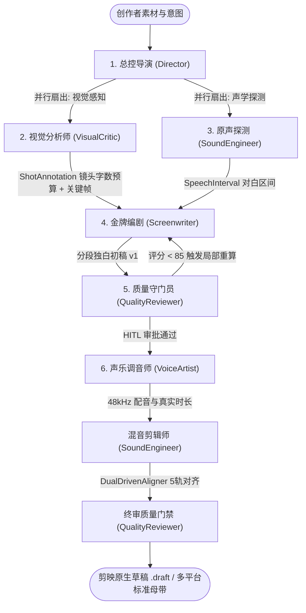

# 6-Agent 电影级剧本与解说编排实战

Dramaxis 的核心引擎在于 **Multi-Agent 状态图协同工作群 (`dramaxis-agent`)**。通过模拟专业影视后期与解说制作团队的岗位分工，将传统的单次脚本生成升级为具备多模态感知、留存张力自反思与人机断点协同 (`HITL`) 的闭环流水线。

---

## 1. 六大智能体角色定义与分工矩阵

| 智能体代号 | 角色职能 | 核心算子与驱动模型 | 输出黑板产物 (`Blackboard`) |
| :--- | :--- | :--- | :--- |
| **`Director` (总控导演)** | 工作流模板调度、参考样本风格解构、HITL 断点审批与靶向精修路由 | `ScriptFlywheelEngine` + 推理模型 (`deepseek-reasoner` / `qwen-max`) | `StyleProfile`, `BreakpointRequest` |
| **`VisualCritic` (视觉分析师)** | 场景硬切检测、关键帧抽取、镜头运动与冲突度打分、单镜字数预算 | `Ffmpeg::detect_scenes` + `SceneRagEngine` | `VisualBriefArtifact` (`Vec<ShotAnnotation>`) |
| **`Screenwriter` (金牌编剧)** | 多模态看图撰稿、黄金 3 秒 Hook 公式应用、按镜头预算生成第一人称独白 | 多模态/创作模型 (`qwen-plus` / `gpt-4o` / `claude-3-7-sonnet-20250219`) | `ScriptArtifact` 版本链 (`v1, v2...`) |
| **`VoiceArtist` (声乐调音师)** | 角色声线匹配、SSML 语速控制、高保真语音合成与真实时长测定 | `EdgeTtsEngine` / `OpenAiTtsEngine` / `GptSovitsTtsEngine` / `MimoTtsEngine` | `VoiceArtifact` |
| **`SoundEngineer` (混音剪辑师)** | 原片与配音 VAD 静音断句、语义+情绪双驱动声画对齐、5 轨装配与 BGM 闪避 | `dramaxis-subtitle::vad` + `DualDrivenAligner` | `AudioBriefArtifact`, `TimelineArtifact`, `Project.timeline` |
| **`QualityReviewer` (质量守门员)** | 剧本留存张力客观评分 + LLM 主观裁判、成片 4-Gate（Hook/同步/节奏/合规）终审 | `ScriptFlywheelEngine` + `LLM-as-a-Judge` + 合规扫描器 | `QualityReportArtifact` |

---

## 2. 编排实战流程

### 步骤 1：选择工作流模板与创作基调

在 **Agent Studio** 机架面板中，可根据业务场景选择三档声明式工作流模板 (`WorkflowProfile`)：

- **`StandardDrama` (完整微短剧 · 9 节点)**：启用视听双分支并发探测、编剧多模态撰稿、`QualityReviewer` 自动反思闭环、HITL 断点精修、配音合成、5 轨对齐与终审门禁。
- **`FastCommentary` (极速影视解说 · 7 节点)**：跳过原片深度声学分段，聚焦关键帧萃取、极速文案生成、HITL 确认与 5 轨对齐。
- **`PureBrollMontage` (纯画面高光混剪 · 4 节点)**：跳过剧本撰写与配音，聚焦镜头高能切点分析与 BGM 动态卡点混流。

### 步骤 2：自反思演化与人机协同断点 (HITL)

Dramaxis 支持两档人机协同策略：

- **全自动生产模式 (`auto_mode = true`)**：智能体团队自动完成撰写、自反思修正与配音对齐，直达母带交付中心。
- **半自动审核模式 (`auto_mode = false`，推荐)**：在剧本质检完成后于 `hitl_approval` 节点自动挂起，创作者可在面板中：
  1. 对比 `v1 / v2` 剧本版本的留存张力评分变化，一键回滚至任意历史版本；
  2. 输入自然语言靶向精修指令（如：`把前3秒改为结果前置型反转，主角语气更冷峻`），系统仅局部失效编剧及下游节点重新推演，完整保留上游昂贵的视听抽样缓存。

---

## 3. 最佳实践建议

1. **严守黄金语速预算**：短剧解说黄金语速约为 `4.3 汉字/秒`，`VisualCritic` 会自动为每个镜头计算 `target_word_budget`，避免台词过长导致音画脱节。
2. **BGM 侧链智能避让**：导出时建议开启 `Audio Ducking`（侧链压缩），在有人声解说时自动平滑压低 BGM 音量，确保旁白清晰通透。
3. **异构模型专精配置 (`AgentModelMatrix`)**：可在设置页为不同智能体分配专精模型（例如为 `VisualCritic` 与 `Screenwriter` 配置具备视觉理解能力的多模态模型，为 `QualityReviewer` 配置高性价比快速模型）。
