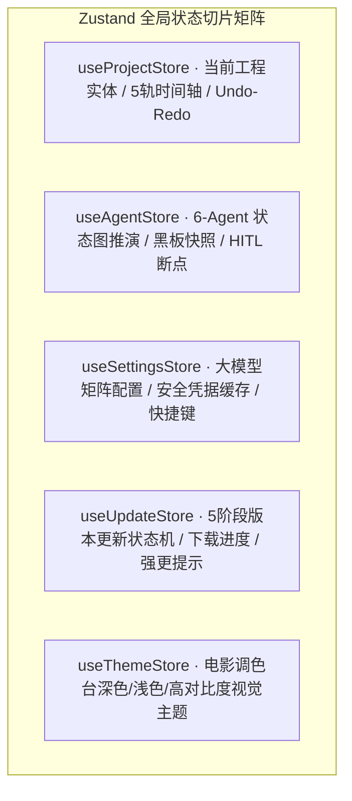

# @dramaxis/core · 全局响应式状态机与业务派生中枢

`@dramaxis/core` 位于 `packages/core`，依托 Zustand 构建轻量、无样板代码的跨组件全局响应式状态切片体系，并集中承载非编时间轴的派生计算、多语言国际化标记与业务通用 Hooks。

---

## 1. 核心状态切片架构 (State Slices)



---

## 2. 核心状态切片职能矩阵

| Store 名称 | 托管的核心状态 | 派生计算 (Derivations) 与操作 |
| :--- | :--- | :--- |
| **`useProjectStore`** | `currentProject: Project \| null`, `isDirty: boolean` | 自动计算总时长、脏检查去抖保存、多轨增删改查 |
| **`useAgentStore`** | `activeRole: AgentRole`, `blackboard: Blackboard` | 留存张力曲线波形、脚本版本链对比、HITL 动作响应 |
| **`useSettingsStore`** | `llmProvider: string`, `agentModelMatrix: Record<...>` | 模型连通性状态判定、音色预设快捷映射 |
| **`useUpdateStore`** | `phase: UpdatePhase`, `progress: UpdateProgress` | 400ms 滑动窗口平滑测速、强制更新全局阻断弹窗 |

---

## 3. 消费与派生示例

```typescript
import { useProjectStore } from "@dramaxis/core";

export function TimelineMonitor() {
  // 细粒度选择器订阅，杜绝多余重渲染
  const duration = useProjectStore((s) => s.currentProject?.timeline.durationSeconds ?? 0);
  const trackCount = useProjectStore((s) => s.currentProject?.timeline.tracks.length ?? 0);

  return (
    <div className="flex items-center gap-2 font-mono text-xs text-gold">
      <span>总时长: {duration.toFixed(2)}s</span>
      <span>活跃轨道: {trackCount} 轨</span>
    </div>
  );
}
```
