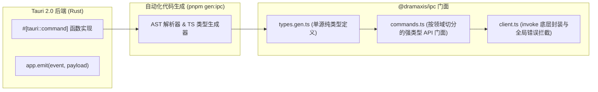

# @dramaxis/ipc · 强类型契约与跨进程通信分发

`@dramaxis/ipc` 位于 `packages/ipc`，是前端 React 19 应用与 Rust 后端 Tauri 2.0 之间的跨进程通信 (IPC) 门面。它通过自动代码生成机制将后端的 Command 签名与 Event Payload 编译为 100% 单源受控的 TypeScript 类型契约。

---

## 1. 架构分层与目录拓扑



---

## 2. 领域 API 门面切分 (`commands.ts`)

门面对象按照领域驱动设计 (DDD) 边界组织，包含完整的智能补全、类型校验与错误转换：

```typescript
import { agentIpc, exportIpc, projectIpc, updateIpc } from "@dramaxis/ipc";

// 1. 项目领域管理
const project = await projectIpc.get("proj_uuid_123");

// 2. 启动 6-Agent 状态图推演 (全自动化推演或 HITL 断点模式)
const context = await agentIpc.start({
  project,
  autoMode: false,
  workflowProfile: "StandardDrama",
});

// 3. 毫秒级直出剪映 PC 原生草稿包 (.draft)
const draft = await exportIpc.capcutDraft({
  project,
  draftName: "【剧枢】绝地反击_EP01",
  exportDir: null, // 默认使用系统识别的剪映工程目录
});
console.log(`剪映工程就绪于: ${draft.draftFolder}`);
```

---

## 3. 全局错误拦截与脱敏保障 (`client.ts`)

- **错误归一化**：将 Rust 端抛出的 `DramaxisError` 统一解构成前端具备确定性判定的 TypeScript 错误类；
- **凭据脱敏防泄露**：底层在接收到 IPC 回包时自动核验数据形态，杜绝敏感密钥在前端持久化存储或打印至浏览器 DevTools 控制台。
